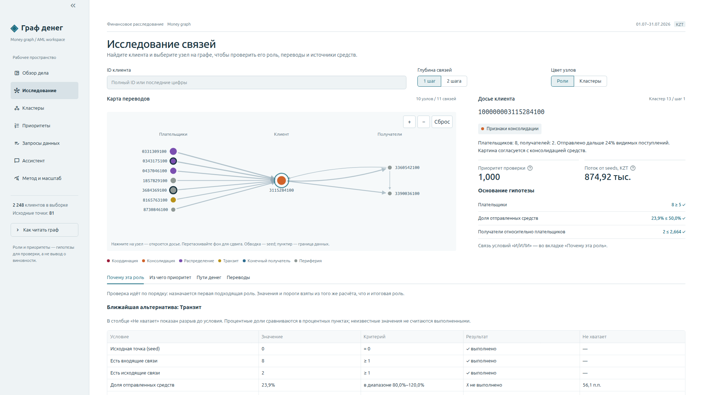

# Money graph — team ker1mGo

**Follow money from known seeds, inspect the evidence, and choose the next data request.**

Hackathon solution for the case «Граф денег». An AML analyst knows 81 clients who received drug-related money
(the *seeds*) and has their outgoing transfers four hops deep: 2,248 clients in total. The tool answers
**"which of these clients should I look at first, and why?"** It gives every client a role, a group and a review
priority, each with the evidence behind it. Every finding is a hypothesis for an analyst to check, never an accusation.



**Demo video:** [demo.webm](hack-c4dedb1a-ker1mgo/docs/media/demo.webm)

## Quick start

All the code lives in [`hack-c4dedb1a-ker1mgo/`](hack-c4dedb1a-ker1mgo/).

```bash
git clone https://github.com/aruzhannurman/hackalem_answer_team_ai-shack.git
cd hackalem_answer_team_ai-shack/hack-c4dedb1a-ker1mgo
docker compose up --build
```

Then open <http://localhost:8501>. No API key is needed.

Without Docker (Python 3.12 and `make`):

```bash
cd hack-c4dedb1a-ker1mgo
python3.12 -m venv .venv
source .venv/bin/activate
pip install -r requirements.txt
make run   # offline pipeline, ~10 s, writes results to out/
make app   # viewer on http://localhost:8501
```

## How it works

1. **Measure every client:** payers and recipients, KZT in and out, centrality, cycles, fast pass-through, amount patterns.
2. **Follow the seed money** along each link in proportion to KZT to estimate how much reaches each client.
3. **Handle the edge of the data:** a model trained on depths 1–3 estimates whether depth-4 clients pass money on.
4. **Assign roles and groups** with six ordered rules and Louvain communities, each with numeric evidence.
5. **Rank for review** by seed money reached, role, source seeds, betweenness and removal impact, with a plain-language `why`.

## Repository layout

```text
hack-c4dedb1a-ker1mgo/
  moneygraph/     Data loading, analytics, rules and export pipeline
  agent/          Read-only graph queries and the optional LLM assistant
  app/            Streamlit viewer: pages, dossier, charts, graph
  tests/          Offline regression and integration tests
  docs/           Architecture, methodology, assistant reference, demo media
  project_docs/   Original task, dataset description and supplied data
  out/            Results snapshot produced by `make run`
```

## Documentation

- [Full project README](hack-c4dedb1a-ker1mgo/README.md) · [Русская версия](hack-c4dedb1a-ker1mgo/README.ru.md)
- [Quickstart (RU)](hack-c4dedb1a-ker1mgo/docs/quickstart-ru.md)
- [Methodology, results and limitations](hack-c4dedb1a-ker1mgo/docs/methodology.md)
- [Architecture and data contract](hack-c4dedb1a-ker1mgo/docs/design.md)
- [Assistant](hack-c4dedb1a-ker1mgo/docs/assistant.md)
